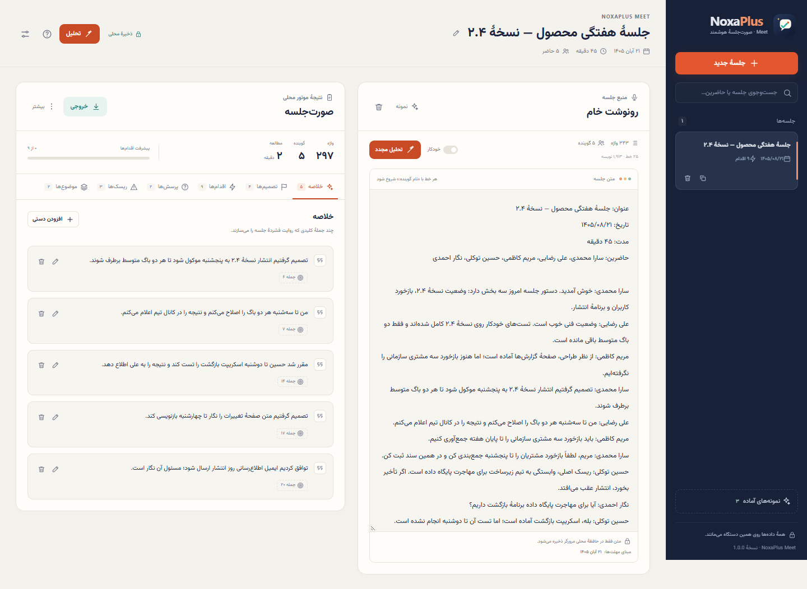

# NoxaPlus Meet

A local-first Persian meeting library and transcript-to-minutes workspace by **NoxaPlus**. Organize meeting transcripts, extract a starting draft of minutes, review the evidence, and track decisions and follow-up actions in your browser.

NoxaPlus Meet uses a **deterministic, rule-based engine**. It is not an AI service, does not perform speech recognition, and does not record or transcribe audio. No account, API key, backend, or model download is required. The interface and generated minutes are Persian and right-to-left; this repository's documentation is English.

- [Open the web app](https://noxaplus-star.github.io/noxaplus-meet/)
- [GitHub repository](https://github.com/noxaplus-star/noxaplus-meet)
- [Official NoxaPlus website](https://www.noxaplus.ir)
- Contact: [NoxaPlus2025@gmail.com](mailto:NoxaPlus2025@gmail.com)



## Contents

- [Quick start: no installation required](#quick-start-no-installation-required)
- [Features](#features)
- [Working with meetings](#working-with-meetings)
- [How extraction works](#how-extraction-works)
- [Saving, backups, and privacy](#saving-backups-and-privacy)
- [Exporting and printing](#exporting-and-printing)
- [Browser and PWA behavior](#browser-and-pwa-behavior)
- [Keyboard shortcuts](#keyboard-shortcuts)
- [Development](#development)
- [Repository layout](#repository-layout)
- [Troubleshooting](#troubleshooting)
- [Contributing and support](#contributing-and-support)
- [License](#license)

## Quick start: no installation required

1. Open the [repository](https://github.com/noxaplus-star/noxaplus-meet) and choose **Code > Download ZIP**.
2. Extract the ZIP into a folder. Do not run the application from inside the archive.
3. Double-click **`index.html` in the extracted repository root** to open it in a modern browser.
4. Explore the included sample or create a meeting, paste a Persian transcript, and run analysis.

The root `index.html` is the ready-to-use standalone application. Its JavaScript, CSS, and Vazirmatn fonts are embedded by the build, so **Node.js, a web server, and an internet connection are not needed to run the standalone app**.

**Do not double-click `app/index.html`.** That file is the Vite source entry, not the standalone application; it requires the development server or a production build. Developers regenerate the root application with `npm run build`.

Alternatively, use the [hosted web app](https://noxaplus-star.github.io/noxaplus-meet/). Browser data belongs to the location and browser profile where you opened the app; it does not automatically transfer between the hosted and downloaded versions.

> Back up before moving, renaming, or replacing your local application folder. Browser storage behavior for `file://` URLs varies by browser and file path. A downloaded JSON backup is the reliable way to carry your workspace with you.

## Features

| Area | Capabilities |
| --- | --- |
| Meeting library | Create, search, select, duplicate, and delete meetings; edit meeting metadata. |
| Persian workspace | Right-to-left transcript editor and minutes panels, Persian date presentation, and light/dark themes. |
| Structured minutes | Extractive summary, decisions, actions, owners, Jalali deadlines, questions, risks, and topics. |
| Review tools | Confidence indicators and source-sentence jumping for extracted items. |
| Manual control | Edit, add, and remove minutes items; adjust action owners and deadlines; mark actions open or done. |
| Reanalysis | Rebuild the complete minutes draft from the current transcript; replaces previous minutes. |
| Automatic analysis | Optional reanalysis after a 1,400 ms pause when an analyzed transcript changes; off by default. |
| Persistence | Browser autosave and full-workspace JSON backup and restore. |
| Sharing | Markdown and escaped, printable HTML; download, copy, HTML preview, and browser print/PDF. |
| Getting started | Built-in meeting samples, in-app help, and keyboard shortcuts. |
| Hosted installation | PWA installation and service-worker offline support where the browser and hosting context support them. |

These tools assist review; they do not guarantee complete or correct extraction.

## Working with meetings

### 1. Create or select a meeting

Use the meeting library to create a blank meeting or open a sample. Meeting metadata includes the title, Jalali date, start time, duration in minutes, participants, and chair.

Set the **meeting date accurately before analysis**. Relative deadlines are resolved against that date, not the date on which you happen to open the app. Enter participant names consistently to help owner matching.

The built-in samples cover:

- A weekly product meeting about a release, customer feedback, and infrastructure risks.
- A service-outage incident review with preventive actions.
- Campaign planning with a publishing calendar, content, budget, and assigned work.

Samples create usable meetings with transcripts and prepared minutes. You can edit or duplicate them without supplying any real meeting data. The Persian example transcripts are also available in [`src/core/sample.ts`](src/core/sample.ts).

### 2. Paste a transcript

The input is **text**, not an audio or video file. If your meeting was recorded, prepare its transcript separately before using NoxaPlus Meet.

For clearer results:

- Start each speaker turn with the speaker's name followed by a colon.
- Prefer one sentence per line, with punctuation and explicit responsibilities.
- Use full participant names consistently rather than ambiguous pronouns or initials.
- State decisions, requested work, owners, and deadlines explicitly.
- Use the supported Persian metadata headers for title, date, start time, duration, participants, and chair; consult the samples for their exact spelling.
- Verify the meeting's metadata in the editor instead of assuming every pasted header has replaced existing values.

Lines without a speaker label can be associated with the preceding speaker. Without any recognized speaker labels, the parser uses an unknown speaker. Review owner assignments carefully in either case.

### 3. Analyze and review

Run analysis from the toolbar, transcript panel, or keyboard shortcut. Review the summary, decisions, actions, questions, risks, and topics in the minutes panel.

Extracted entries retain source references. Use an entry's source-sentence control to jump back to the relevant transcript text. Manually added entries do not have a transcript source.

Confidence indicators distinguish high-confidence pattern matches from items needing review. They are **heuristic labels, not statistical probabilities or guarantees**. Always verify owners, deadlines, and consequential decisions, including high-confidence items.

### 4. Refine the minutes

Edit wording, add missing entries, remove incorrect ones, correct owners and Jalali deadlines, and switch action status between **open** and **done**. **Reanalysis replaces all minutes, including manual edits, additions, and action statuses. Disable automatic analysis before refining a draft, and export or duplicate the meeting before reanalyzing reviewed work.**

When automatic analysis is enabled, changes to an already analyzed transcript trigger reanalysis after a 1,400 ms pause. Run the initial analysis explicitly for a blank meeting. You can disable automatic analysis in Settings and analyze on demand.

Review the result again after substantial transcript changes: extraction and source references depend on the current text. Source jumping is unavailable until analysis is current. Back up important reviewed minutes before major revisions or clearing data.

## How extraction works

The engine runs locally using text normalization and explicit Persian-language patterns:

1. Normalize matching text, including digit and character variants.
2. Parse metadata, speaker turns, sentences, and source offsets.
3. Match cues for decisions, obligations, action verbs, questions, risks, and topics.
4. Attempt owner matching using names, participant lists, and speaker context.
5. Resolve supported date expressions using Jalali calendar utilities and the meeting date.
6. Select source-derived summary lines and produce structured minutes and transcript statistics.

The same transcript, meeting date, and participant inputs produce the same rule-based extraction content. Generated identifiers and analysis timestamps are bookkeeping, not semantic output.

### Dates and limitations

Supported date patterns include numeric dates, Persian month names, weekdays, relative days or weeks, and some period boundaries. Jalali date keys are stored as `YYYY-MM-DD`, for example `1405-08-21`. Not every natural-language deadline is resolvable; a missing deadline remains unset and can be entered manually.

Important limitations:

- The engine does not understand meaning like a human or a semantic AI model.
- It may miss indirect commitments, unusual phrasing, implied owners, or unrecognized date expressions.
- Mentioned tasks or risk words may produce false positives.
- A question listed in the questions section is not proof that it remained unanswered later in the meeting.
- Summaries are extractive starting drafts, not a guaranteed complete account of the discussion.
- Relative expressions are anchored to the meeting date; ambiguous event-relative deadlines need manual review.
- Persian is the intended extraction language. Do not assume equivalent extraction quality for other languages.

Human review is required before circulating minutes or treating them as an authoritative record.

## Saving, backups, and privacy

### Browser autosave

Meetings, transcripts, minutes, and settings are saved in the current browser's `localStorage`. There is no remote database, cloud synchronization, or account-based recovery.

Autosave runs after a 250 ms pause. Allow it to finish before closing the tab. Safe writes require the Web Locks API, available in current major browsers; unsupported browsers keep the workspace in memory and display a backup warning.

Writes are serialized across tabs and checked against the exact previously saved snapshot. When another tab changes the saved workspace, this tab stops saving and shows a persistent conflict warning instead of overwriting newer data, including when closing the tab. Download this tab's backup before reloading; changes are not merged automatically. An explicitly confirmed backup restore or reset replaces the workspace.

Failed autosaves display a persistent warning with a backup download button. If existing saved data cannot be read, it is kept untouched and autosave is paused; download the recovery data, then restore a valid backup or explicitly reset the workspace in Settings.

Browser storage is not a backup. Private browsing, blocked storage, quota limits, browser cleanup, profile changes, or clearing site data can remove or prevent persistence. For local `file://` use, moving or renaming the HTML file or its folder may change which saved workspace the browser exposes.

### Full JSON backup and restore

In **Settings**, download a JSON backup to save all meetings, transcripts, minutes, and settings. Restore that file in the destination browser or device to transfer the workspace.

- Restore accepts NoxaPlus Meet backup JSON, not arbitrary transcript JSON.
- The application validates the backup identity, version, and workspace structure.
- The restore file limit is **10 MB as enforced by the app: 10 × 1024 × 1024 bytes (10 MiB)**. Files larger than that are rejected.
- **Restore replaces the current workspace; it does not merge libraries.** Download a backup of the current workspace first.
- Markdown and HTML exports contain meeting minutes, not a full restorable workspace. Use JSON for recovery and migration.

Back up before restoring, deleting meetings, clearing all data, switching browsers, or relocating a local copy. Store backups somewhere separate from the application folder.

### Privacy boundaries

Transcript analysis, autosave, and export generation happen in the browser. The app does not require API keys, upload meeting content for analysis, or include analytics or tracking tools.

However, **local-first does not mean encrypted**. Browser storage, JSON backups, and exported minutes are not encrypted by the app. Anyone with access to your device, browser profile, downloaded files, or clipboard may be able to read them. Browser extensions and software on the device can also affect privacy.

Opening the hosted app loads application assets from its host. Following external links, installing development dependencies, or using browser/OS services can involve network activity outside the local extraction engine. Protect sensitive meeting content and follow your organization's retention and sharing policies.

## Exporting and printing

Open the export dialog for the active meeting:

| Format or action | Purpose |
| --- | --- |
| Markdown | Share editable text, including metadata, minutes sections, and an actions table. Download or copy the output. |
| HTML | Download an independent, styled Persian RTL minutes document with escaped user text and print styling. |
| HTML preview | Open the generated document in a new tab; browser pop-up rules may apply. |
| Print / PDF | Use the browser's print dialog. Select its PDF destination if one is available. |
| JSON backup | Preserve the entire workspace from Settings rather than the meeting export dialog. |

Clipboard access depends on browser support, permissions, and security context. **Downloads remain available even when copying is unavailable**. If HTML preview is blocked, download the HTML file and open it directly.

PDF creation uses the browser's printing facilities; there is no separate PDF-generation engine. Fonts and pagination in exported documents can differ by browser and device. The embedded Vazirmatn fonts in the standalone application do not imply font embedding in every exported minutes document.

HTML export escapes user-supplied text; it does not interpret the transcript as executable HTML. Markdown is an editable text format, not a general-purpose sanitizer. Review the behavior of any external Markdown renderer before publishing untrusted content.

## Browser and PWA behavior

Use a modern browser with JavaScript enabled. Browser features such as local file handling, storage, clipboard access, print/PDF, and install prompts vary by browser and platform.

There are two different offline paths:

- **Standalone HTML:** open the root `index.html` from disk. Its embedded application code, styles, and fonts work without a server or internet connection. A service worker is not needed for this mode.
- **Hosted PWA:** open the app over **HTTPS or localhost**. Service-worker registration and PWA installation require a supported secure hosting context; they do not work from `file://`. First load the hosted app while online so its offline resources can be cached.

An install control appears only when the browser offers an installation prompt. Other browsers may provide installation through their own menus, or may not offer it at all. Offline caches can be cleared or evicted. Installation does not add cloud synchronization, encryption, or automatic backup.

## Keyboard shortcuts

| Shortcut | Action |
| --- | --- |
| `N` | Open the new-meeting dialog. |
| `Ctrl + Enter` / `Cmd + Enter` | Analyze the current non-empty transcript. |
| `?` | Open help. |
| `Esc` | Close dialogs or the open library drawer. |

Single-key shortcuts are ignored while typing in form fields. Analysis is not triggered behind an open modal.

## Development

Development needs Node.js and npm; using the finished standalone application does not. Use a Node.js version compatible with Vite: **Node.js 22.12 or newer is recommended**, or a supported Node.js 20 release at least 20.19. The broad package engine declaration alone is not sufficient for older Node.js 20 versions.

### Set up and run

```sh
git clone https://github.com/noxaplus-star/noxaplus-meet.git
cd noxaplus-meet
npm install
npm run dev
```

Open the local URL printed by Vite. Dependency installation normally requires internet access; application analysis itself does not call an external service.

### Commands

| Command | Purpose |
| --- | --- |
| `npm install` | Install project dependencies. |
| `npm run dev` | Start the Vite development server. |
| `npm test` | Run the Vitest test suite once. |
| `npm run test:watch` | Run tests in watch mode. |
| `npm run typecheck` | Check TypeScript without emitting files. |
| `npm run build` | Check TypeScript, build with Vite, inline the application bundles, and synchronize the generated root `index.html`. |
| `npm run preview` | Serve the production build locally after building. |
| `npm run icons` | Regenerate application/PWA icons. |

The production build uses the source entry in `app/index.html` and writes the web build to `dist/`. JavaScript, CSS, and font assets are embedded in the application HTML, and the finished application is synchronized to the repository root for direct opening. Hosted PWA resources are separate supporting assets; embedding the standalone application does not make `file://` a service-worker context.

Do not hand-edit the generated root `index.html`. Change source files and rebuild. When publishing a hosted build, keep its accompanying manifest, icons, and service-worker resources with it rather than treating the root HTML alone as a full PWA deployment.

### Verification

```sh
npm test
npm run typecheck
npm run build
npm run preview
```

Tests cover the core engine and utilities, including normalization/digits, Jalali calendar and deadline handling, transcript parsing, analysis, models, storage, and exports. The test count changes as coverage grows; use the current test output rather than a fixed count in documentation.

Also verify the generated root `index.html` directly from disk with networking disabled. A passing test suite or working development server alone does not verify standalone packaging, clipboard behavior, print layout, or hosted PWA caching.

## Repository layout

| Path | Role |
| --- | --- |
| `index.html` | Generated standalone application for end users. |
| `app/index.html` | Vite source HTML entry. |
| `src/App.tsx` | Main application shell and workspace coordination. |
| `src/components/` | Library, transcript and minutes panels, editable rows, dialogs, and shared UI. |
| `src/hooks/` | Workspace state, local persistence integration, notifications, and install-prompt handling. |
| `src/core/` | Typed models, deterministic extraction, parsing, date utilities, sample transcripts, storage validation, and export generation. |
| `src/core/*.test.ts` | Unit tests for the core behavior. |
| `public/` | Static hosting and PWA resources. |
| `scripts/` | Build-support and icon-generation tooling. |
| `vite.config.ts` | Source/build paths, relative asset handling, and HTML bundle inlining. |
| `dist/` | Generated production web build. |

The application uses React, TypeScript, Vite, Vitest, and Vazirmatn. Icon generation uses Sharp. Third-party software and fonts retain their own licenses.

## Troubleshooting

| Problem | What to check |
| --- | --- |
| Double-clicking shows an empty or broken page | Extract the ZIP fully and open the root `index.html`, not `app/index.html`. Enable JavaScript and use a modern browser. |
| Saved meetings disappeared after moving the folder | Return to the previous path/browser profile if available, export JSON there, and restore it at the new location. Local file storage is browser-dependent. |
| Data is lost after closing the browser | Check private browsing, blocked storage, cleanup settings, and quotas. Download JSON backups instead of relying solely on autosave. |
| Wrong owner or deadline | Check speaker labels, participant names, and the meeting date. Correct the minutes manually; unsupported phrasing is not guaranteed to extract. |
| A new transcript is not analyzing automatically | Run the initial analysis explicitly and check the automatic-analysis setting. Subsequent changes use a 1,400 ms delay. |
| Copy does not work | Use Download. Clipboard permissions and `file://` support vary. |
| HTML preview does not open | Allow the relevant pop-up or download and open the HTML file instead. |
| No installation option | Use HTTPS or localhost and a browser that supports PWA installation; `file://` is standalone mode, not PWA mode. |
| Restore is rejected | Use a NoxaPlus Meet backup with a supported structure/version and a size no greater than 10 MiB. Back up the current workspace before retrying a restore. |
| Vite fails on Node.js 20 | Check the exact Node.js version. Vite needs at least 20.19 on that release line; use a compatible newer Node.js version. |

## Contributing and support

- Read [CONTRIBUTING.md](CONTRIBUTING.md) for setup, checks, and contribution guidance.
- Follow [CODE_OF_CONDUCT.md](CODE_OF_CONDUCT.md) in project community spaces.
- Report reproducible non-sensitive bugs or propose features through [GitHub Issues](https://github.com/noxaplus-star/noxaplus-meet/issues).
- Report vulnerabilities privately as described in [SECURITY.md](SECURITY.md); do not include sensitive transcripts in public issues.
- See [CHANGELOG.md](CHANGELOG.md) for release notes.

For general contact, use [NoxaPlus2025@gmail.com](mailto:NoxaPlus2025@gmail.com). NoxaPlus's official website is [www.noxaplus.ir](https://www.noxaplus.ir).

## License

NoxaPlus Meet is released under the [MIT License](LICENSE).

Copyright (c) 2026 NoxaPlus. Third-party dependencies and bundled fonts remain subject to their respective licenses. The MIT License does not grant rights to NoxaPlus trademarks or branding.
